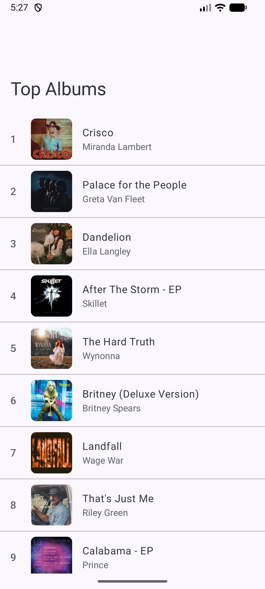
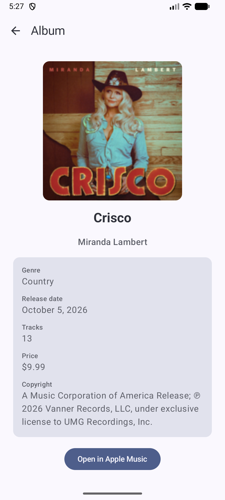

# Top Albums 🎵

An Android sample application built with modern Android development best practices, Clean Architecture, Jetpack Compose, and Koin. It fetches and displays the top albums (e.g., from the iTunes API) and allows users to inspect detailed album information, track listings, copyright details, and open links directly in Apple Music.

---

## 📱 Screenshots

| Album List Screen | Album Detail Screen |
| :---: | :---: |
|  |  |

---

## 🏛️ Architecture & Project Structure

The project follows **Clean Architecture** principles and is organized into a modular multi-module setup:

- **`:app`**: Main entry point (`TopAlbumsApplication`, `MainActivity`), navigation routing (`TopNavHost`), and theme configuration.
- **`:core:domain`**: Pure Kotlin domain models (`Album`), domain interfaces (`AlbumRepository`), and error handling (`AppError`).
- **`:core:data`**: Data layer implementation (`DefaultAlbumRepository`), Ktor API client (`ITunesApi`, `HttpClientFactory`), DTOs, and mapping logic.
- **`:core:ui`**: Shared UI design system components, Material 3 theme (`Theme.kt`), error views, and loading states.
- **`:feature:albumlist`**: Feature module for the top albums browse screen (`AlbumListScreen`, `AlbumListViewModel`, `AlbumListUiState`).
- **`:feature:albumdetail`**: Feature module for the album detail view (`AlbumDetailScreen`, `AlbumDetailViewModel`, `AlbumDetailUiState`).

---

## 🛠️ Tech Stack

- **UI**: [Jetpack Compose](https://developer.android.com/jetpack/compose) & [Material 3](https://m3.material.io/)
- **Architecture**: Clean Architecture, MVVM, Unidirectional Data Flow (UDF) with Kotlin StateFlow
- **Dependency Injection**: [Koin](https://insert-koin.io/)
- **Networking**: [Ktor Client](https://ktor.io/) & [Kotlinx Serialization](https://github.com/kotlin/kotlinx.serialization)
- **Image Loading**: [Coil](https://coil-kt.github.io/coil/)
- **Asynchronous Programming**: Kotlin Coroutines & Flows
- **Build System**: Gradle with Kotlin DSL (`build.gradle.kts`)
